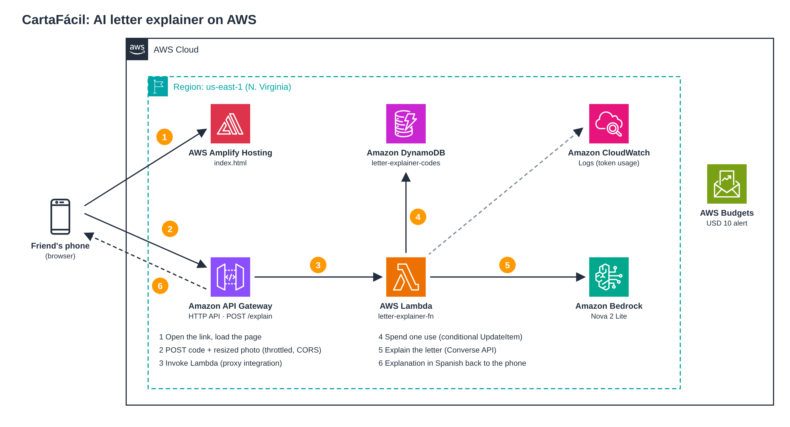

# CartaFácil: AI letter explainer on AWS

Snap a photo of an official letter written in English and get a plain-Spanish explanation: what it says, what you have to do, by when, how much to pay, who to call, and any free help the letter offers.

Serverless, console-only, about 0.2-0.3 cents per letter.

## How it works

1. A friend opens the link on their phone and types their code. The page is a single `index.html` on **AWS Amplify Hosting**.
2. The page shrinks the photo in the browser (1600 px JPEG) and sends it with the code to **Amazon API Gateway** (HTTP API, `POST /explain`, throttled, CORS locked to the Amplify domain).
3. API Gateway invokes **AWS Lambda** (Python 3.13, boto3 only).
4. Lambda spends one use of the code in **Amazon DynamoDB** with a single conditional `UpdateItem` (exists, active, uses left > 0). Invalid or used-up codes never reach the AI.
5. Lambda sends the photo and a strict system prompt to **Amazon Bedrock** (Amazon Nova 2 Lite, Converse API).
6. The explanation comes back as fixed JSON and the page renders it.

Safety nets in code, not in the prompt: links that are not literally in the letter are dropped (text input), the weekday of a date is computed with `datetime` (the model got it wrong in testing), and every "not in the letter" variant becomes one marker, `NOT_IN_LETTER`.

## Repository

| Path | What it is |
|---|---|
| `lambda/lambda_function.py` | The Lambda function |
| `iam/iam-policy-bedrock.json` | Inline policy: invoke Nova 2 Lite only |
| `iam/iam-policy-dynamodb.json` | Inline policy: `UpdateItem` on the codes table only |
| `web/index.html` | The web page (replace `<YOUR_API_ID>`) |
| `scripts/create-codes.sh` | Creates codes in bulk from CloudShell |
| `tests/` | Console test events and a fake letter image (fictional organizations) |
| `architecture.png` / `.svg` | Diagram |

## Setup (console)

All resources in **us-east-1**.

1. **Budget:** AWS Budgets, monthly cost budget, USD 10, email alert.
2. **Lambda:** `letter-explainer-fn`, Python 3.13, paste `lambda/lambda_function.py`, Deploy. Timeout **30 s**.
3. **IAM:** on the function's role, add two inline policies from `iam/` (`BedrockNova2LiteOnly`, `DynamoDBCodesOnly`).
4. **DynamoDB:** table `letter-explainer-codes`, partition key `code` (String), on-demand. Add an item: `code`=`TEST-7K2P`, `friend`=`Test`, `uses_left`=4 (Number), `active`=true (Boolean).
5. **Test** in the Lambda console with the files in `tests/`.
6. **API Gateway:** HTTP API `letter-explainer-api`, Lambda integration, route `POST /explain`, stage `$default` with auto-deploy. Throttling: rate 2, burst 5. CORS: origin `*` (temporary), method `POST`, header `content-type`.
7. **Web page:** in `web/index.html` replace `<YOUR_API_ID>` with your Invoke URL id. Zip `index.html` and deploy it in **Amplify > Deploy without Git**.
8. **Lock CORS:** change `Access-Control-Allow-Origin` from `*` to your exact Amplify URL (`https://main.xxxx.amplifyapp.com`, no trailing slash).
9. **Codes:** add one item per person in DynamoDB, or edit and run `scripts/create-codes.sh` in CloudShell to create several at once.

Optional environment variables on the Lambda: `OUTPUT_LANGUAGE` (default `Spanish`), `MODEL_ID` (default `us.amazon.nova-2-lite-v1:0`), `CODES_TABLE`.

## Limitations

- Not legal, medical or financial advice. The page says so.
- Links read from a **photo** can't be checked against the text, so the page asks people to compare them with the printed letter.
- Codes like `CARTA-ANA` are easy to guess. Each one only has 4 uses, so the damage is capped, but random suffixes are safer.
- No authentication beyond the codes, no WAF (HTTP APIs don't support it), no infrastructure as code.

## Cleanup

| Order | Resource | Where |
|---|---|---|
| 1 | Amplify app `letter-explainer-web` | Amplify > App settings > General > Delete app |
| 2 | HTTP API `letter-explainer-api` | API Gateway > APIs > Delete |
| 3 | Lambda `letter-explainer-fn` | Lambda > Functions > Actions > Delete |
| 4 | IAM role `letter-explainer-fn-role-...` | IAM > Roles > Delete |
| 5 | Log group `/aws/lambda/letter-explainer-fn` | CloudWatch > Log groups > Delete |
| 6 | DynamoDB table `letter-explainer-codes` | DynamoDB > Tables > Delete |
| 7 | Budget `letter-explainer-budget` (optional) | Billing > Budgets > Delete |

## License

MIT. See `LICENSE`.
